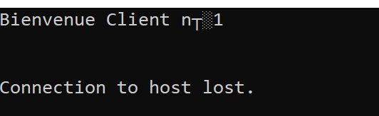
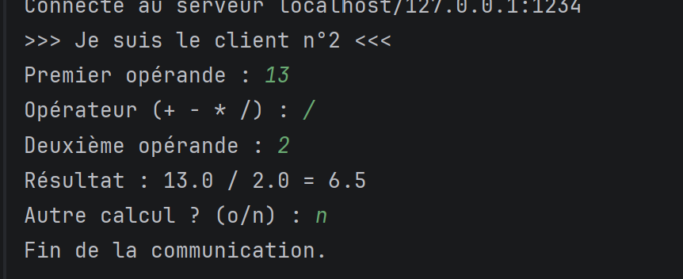

# TP3 - Développement des Applications Réparties

## Serveur Multi-Clients et Calculatrice Multi-Thread

**Nom :** Saidi  
**Prénom :** Rahma  
**Classe :** LSI3  
**Module :** Développement des Applications Réparties

---

# Objectif du TP

L'objectif de ce TP est de mettre en pratique les concepts fondamentaux des applications réparties en Java à travers l'utilisation des sockets TCP, des threads et de la sérialisation d'objets.

Les objectifs visés sont :

- Comprendre le modèle Client/Serveur.
- Utiliser les sockets TCP pour établir une communication réseau.
- Développer un serveur capable de gérer plusieurs clients simultanément.
- Utiliser les threads pour exécuter plusieurs traitements en parallèle.
- Échanger des objets Java sérialisés entre client et serveur.
- Concevoir une calculatrice distribuée.
- Découvrir les mécanismes de synchronisation dans les applications multi-thread.

---

# Activité 3-1 : Serveur Multi-Clients

## Présentation

Cette activité consiste à développer un serveur TCP capable d'accepter plusieurs connexions clientes simultanément.

Lorsqu'un client se connecte :

1. Le serveur accepte la connexion.
2. Un thread dédié est créé.
3. Un numéro unique est attribué au client.
4. Un message de bienvenue est envoyé.

Cette approche permet au serveur de rester disponible même si plusieurs clients se connectent au même moment.

---

## Architecture

```text
               Client 1
                   |
               Thread 1
                   |
Client 2 ----- Serveur ----- Client 3
                   |
               Thread 2
                   |
               Thread 3
```

---

## Structure du projet

```text
Activite31
│
├── Client.java
├── ClientProcess.java
└── Server.java
```

---

## Description des classes

### Server.java

Classe principale du serveur.

Rôle :

- Ouverture du port d'écoute.
- Acceptation des connexions clientes.
- Attribution d'un numéro unique à chaque client.
- Création d'un thread pour chaque connexion.

### ClientProcess.java

Classe héritant de `Thread`.

Rôle :

- Gérer la communication avec un client spécifique.
- Envoyer le message de bienvenue.
- Fermer la connexion après l'envoi du message.

### Client.java

Rôle :

- Se connecter au serveur.
- Recevoir le message envoyé.
- Afficher le message de bienvenue.

---

# Exécution de l'application

## Démarrage du serveur

Le serveur est lancé puis reste en attente des connexions clientes.


La capture montre que plusieurs clients se sont connectés simultanément au serveur. Chaque client reçoit un numéro unique permettant son identification.

---

## Connexion des clients

Après connexion au serveur, chaque client reçoit automatiquement un message de bienvenue.

Résultat obtenu :

```text
Bienvenue Client n°1
Bienvenue Client n°2
Bienvenue Client n°3
```

Cette exécution confirme le bon fonctionnement du mécanisme multi-thread mis en place côté serveur.

---

# Test avec Telnet

Afin de vérifier la communication TCP indépendamment du programme client Java, un test a été réalisé avec Telnet.

Commande utilisée :

```cmd
telnet localhost 1235
```

Résultat :

```text
Bienvenue Client n°1
```



Le message « Connection to host lost » est normal puisque le serveur ferme volontairement la connexion après l'envoi du message de bienvenue.

---

# Activité 3-2 : Calculatrice Multi-Thread

## Présentation

Cette activité consiste à développer une calculatrice distribuée basée sur l'échange d'objets Java sérialisés.

Le client saisit une opération mathématique puis envoie un objet `Operation` au serveur.

Le serveur :

- Reçoit l'objet.
- Effectue le calcul demandé.
- Retourne le résultat au client.

Chaque client est traité par un thread indépendant.

---

## Architecture

```text
                 Client 1
                     \
                      \
                       \
Client 2  ----------> Serveur ----------> Résultat
                       /
                      /
                     /
                 Client 3
```

---

## Structure du projet

```text
ClientPackage
│
└── Client.java

ServerPackage
│
├── Server.java
└── ClientProcess.java

CommonPackage
│
└── Operation.java
```

---

# Description des classes

## Operation.java

Classe sérialisable servant à transporter les données entre le client et le serveur.

Attributs :

```java
double op1;
double op2;
char operateur;
double resultat;
```

Elle implémente l'interface :

```java
Serializable
```

afin que l'objet puisse être transmis à travers le réseau.

---

## Client.java

Rôle :

- Lire les données saisies par l'utilisateur.
- Créer un objet `Operation`.
- Envoyer l'objet au serveur.
- Recevoir le résultat calculé.

---

## Server.java

Rôle :

- Écouter les demandes clientes sur le port 1234.
- Accepter les connexions.
- Créer un thread pour chaque client.

---

## ClientProcess.java

Rôle :

- Recevoir l'objet `Operation`.
- Effectuer le calcul demandé.
- Retourner le résultat.
- Mettre à jour le compteur partagé.

---

# Calculs pris en charge

## Addition

```text
10 + 5 = 15
```

## Soustraction

```text
20 - 4 = 16
```

## Multiplication

```text
5 * 3 = 15
```

## Division

```text
18 / 2 = 9
```

---

# Gestion du compteur partagé

Le serveur maintient un compteur global permettant de suivre le nombre total d'opérations traitées.

Exemple :

```java
compteur++;
```

Afin d'éviter les problèmes d'accès concurrent, les méthodes manipulant le compteur utilisent :

```java
synchronized
```

Exemple d'affichage :

```text
Compteur = 1
Compteur = 2
Compteur = 3
Compteur = 4
```

Cette synchronisation garantit que plusieurs threads ne modifient pas simultanément la variable partagée.

---

# Tests Réalisés

## Exemple d'opération

La capture suivante montre l'exécution d'une division.



L'utilisateur saisit :

```text
13 / 2
```

Résultat obtenu :

```text
13.0 / 2.0 = 6.5
```

Le serveur reçoit l'objet, effectue le calcul puis renvoie le résultat correct au client.

---

## Test Multi-Clients

Plusieurs clients ont été exécutés simultanément.

Résultats observés :

- Chaque client reçoit sa réponse correctement.
- Le serveur continue à fonctionner sans interruption.
- Les calculs sont exécutés indépendamment.
- Le compteur partagé s'incrémente correctement.

Ces résultats démontrent le bon fonctionnement du serveur multi-thread.

---

# Analyse des Résultats

Les tests réalisés montrent que les objectifs du TP ont été atteints.

Pour l'activité 3-1, le serveur accepte simultanément plusieurs connexions grâce à l'utilisation des threads. Chaque client est identifié par un numéro unique et reçoit sa réponse indépendamment des autres clients.

Le test réalisé avec Telnet a permis de vérifier le bon fonctionnement de la communication TCP sans utiliser le programme client Java.

Pour l'activité 3-2, l'échange d'objets Java sérialisés entre le client et le serveur a été correctement mis en œuvre. Le serveur traite les calculs puis renvoie les résultats attendus.

La gestion des threads permet de traiter plusieurs demandes en parallèle tandis que la synchronisation du compteur garantit la cohérence des données partagées.

---

# Difficultés Rencontrées

Durant la réalisation du TP, plusieurs difficultés ont été rencontrées :

- Compréhension du modèle Client/Serveur.
- Gestion des sockets TCP.
- Création et exécution des threads.
- Utilisation des flux d'objets Java.
- Synchronisation des ressources partagées.
- Réalisation des tests multi-clients.

Ces difficultés ont été surmontées grâce à l'étude du fonctionnement des applications réparties et à la mise en pratique des concepts vus en cours.

---

# Conclusion

Ce TP nous a permis de mettre en pratique les notions fondamentales de la programmation répartie en Java.

La première activité a montré comment développer un serveur TCP capable d'accepter plusieurs connexions simultanément grâce aux threads.

La seconde activité a permis de développer une calculatricets Java et les communications réseau.

Nous avons également étudié les mécanismes de synchronisation nécessaires au bon fonctionnement des applications multi-thread.

Les connaissances acquises durant ce TP constituent une base importante pour l'étude des architectures distribuées, des services Web et des architectures orientées services (SOA).